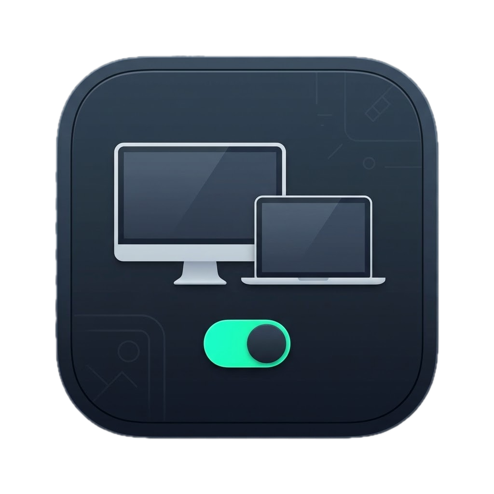

<p align="center">
  
</p>

<h1 align="center">DisplayToggle</h1>

<p align="center">
  A native macOS menu bar utility to turn displays on and off — external monitors, the built-in screen and iPad Sidecar sessions — without unplugging a single cable.
</p>

<p align="center">
  <a href="#español">Español</a> · <a href="#license">License: GPLv3</a>
</p>

---

## Features

- **Independent display control** — every connected display gets its own switch. Turning a monitor off removes it from the desktop arrangement (windows move to the remaining screens) while the cable stays plugged in. Displays turned off by the app stay listed as *Off* so you can bring them back with one click.
- **Safety locks** — you can never turn off the last active display. The built-in screen can only be turned off while another *physical* external monitor is active; a wireless Sidecar/AirPlay screen never counts as a fallback, because it can drop at any moment. Locked switches are greyed out with a short reason underneath.
- **iPad Sidecar support** — connect and disconnect your iPad from the menu, even when it isn't currently attached. The app tells you whether the session runs over **USB** or **AirPlay** (live USB detection via IOKit), and remembers iPads it has seen. Sidecar sessions are always opened/closed cleanly — never by disabling the virtual framebuffer.
- **Live language switching (EN / ES)** — right‑click the menu bar icon → *Language*. The whole UI updates instantly; the choice is saved and defaults to your system language.
- **Automatic recovery** — every display the app turns off is recorded in `UserDefaults` *before* the change is applied. On quit (`quitAppSafely()`, the context menu, ⌘Q, logout) all of them are turned back on, and if the app was force‑quit or crashed, they are restored on the next launch. Changes are also session‑only, so a reboot always brings every display back.
- **Quick access** — *Arrange…* opens macOS Displays settings; left click opens the popover, right click (or Control‑click) opens a native context menu.

## Requirements

| | |
|---|---|
| macOS | 13 Ventura or later |
| Hardware | Apple Silicon (tested). Intel Macs: the build script targets the host architecture, but this is untested. |
| Tools | Xcode or the Xcode Command Line Tools (`xcode-select --install`) for `swiftc` |
| Sidecar | An iPad compatible with Sidecar, signed in with the same Apple Account |

## Building

The app is a single Swift file built with `swiftc`; there is no Xcode project or Swift package yet, so `swift build` / `xcodebuild` are not used.

```bash
git clone https://github.com/Wispero/DisplayToggle.git
cd DisplayToggle
./build.sh
open build/DisplayToggle.app
```

`build.sh` compiles `App/DisplayToggleApp.swift`, writes the `Info.plist` (`LSUIElement = true`, so there is no Dock icon) and ad‑hoc signs the bundle. To use your own bundle identifier:

```bash
BUNDLE_ID=com.example.displaytoggle ./build.sh
```

Because the build is ad‑hoc signed, Gatekeeper may block the first launch: right‑click the app → **Open**, or allow it in **System Settings › Privacy & Security**.

### Permissions

None are needed for normal use. Only the Sidecar fallback — used when the private Sidecar API refuses to connect — drives Control Center through UI scripting, which requires granting DisplayToggle **Accessibility** and **Automation › System Events** access. With ad‑hoc signing, macOS may ask again after every rebuild.

## ⚠️ Private APIs

DisplayToggle relies on undocumented Apple APIs:

- `CGSConfigureDisplayEnabled` (CoreGraphics / SkyLight) to enable and disable displays.
- `SidecarCore.framework` (`SidecarDisplayManager`), loaded at runtime with `dlopen`, to connect and disconnect Sidecar sessions.

These APIs are not allowed on the Mac App Store, so DisplayToggle is distributed as source / outside the App Store. They may change or disappear in any macOS update. The app loads them defensively and shows an error instead of crashing, but some features could stop working on future releases. Use at your own risk.

## Project structure

```
App/DisplayToggleApp.swift   Menu bar app (SwiftUI + AppKit status item)
build.sh                     Build, Info.plist and ad-hoc signing → build/DisplayToggle.app
toggledisplay.png            App icon artwork
```

---

## Español

**DisplayToggle** es una utilidad nativa para la barra de menú de macOS que enciende y apaga monitores externos, la pantalla integrada y sesiones de Sidecar del iPad sin desconectar cables.

- Un switch por pantalla. Las que apaga la app siguen en la lista como *Apagada*.
- Nunca deja apagar la última pantalla activa. La pantalla integrada solo se apaga si hay otro monitor físico externo activo; Sidecar/AirPlay no cuenta como respaldo.
- Conecta y desconecta el iPad por Sidecar desde el menú e indica si la sesión va por **USB** o **AirPlay**.
- Idioma español/inglés en vivo: clic derecho en el ícono → *Idioma*.
- Recuperación automática: las pantallas apagadas se guardan en `UserDefaults` y se vuelven a encender al salir (`quitAppSafely()`) o en el siguiente arranque si la app se cerró a la fuerza.

**Compilar:** requiere macOS 13 o posterior y las herramientas de línea de comandos de Xcode. Ejecuta `./build.sh` y abre `build/DisplayToggle.app`.

**Aviso:** usa APIs privadas de Apple (`CGSConfigureDisplayEnabled`, `SidecarCore`), por lo que se distribuye fuera de la Mac App Store y podría dejar de funcionar en futuras versiones de macOS.

---

## License

DisplayToggle is free software: you can redistribute it and/or modify it under the terms of the **GNU General Public License v3.0** as published by the Free Software Foundation. See [`LICENSE`](LICENSE) for the full text.

This program is distributed in the hope that it will be useful, but **without any warranty**; without even the implied warranty of merchantability or fitness for a particular purpose.
